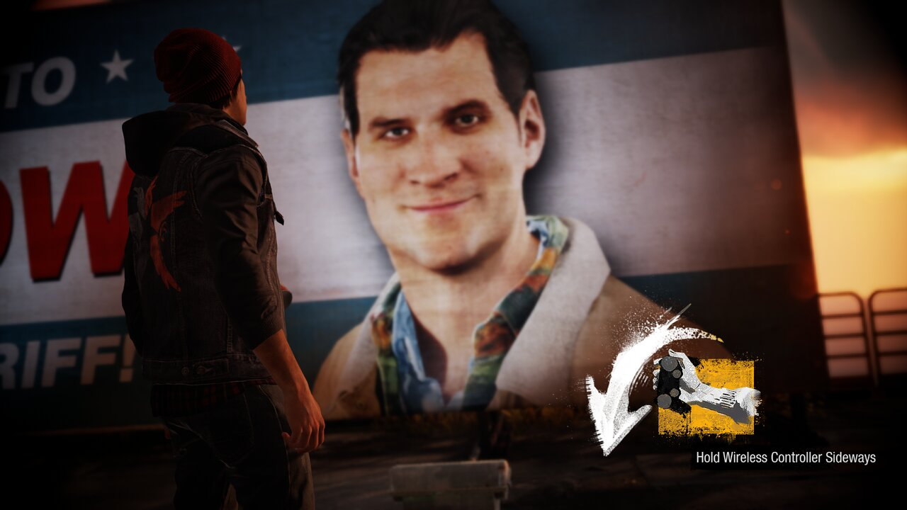
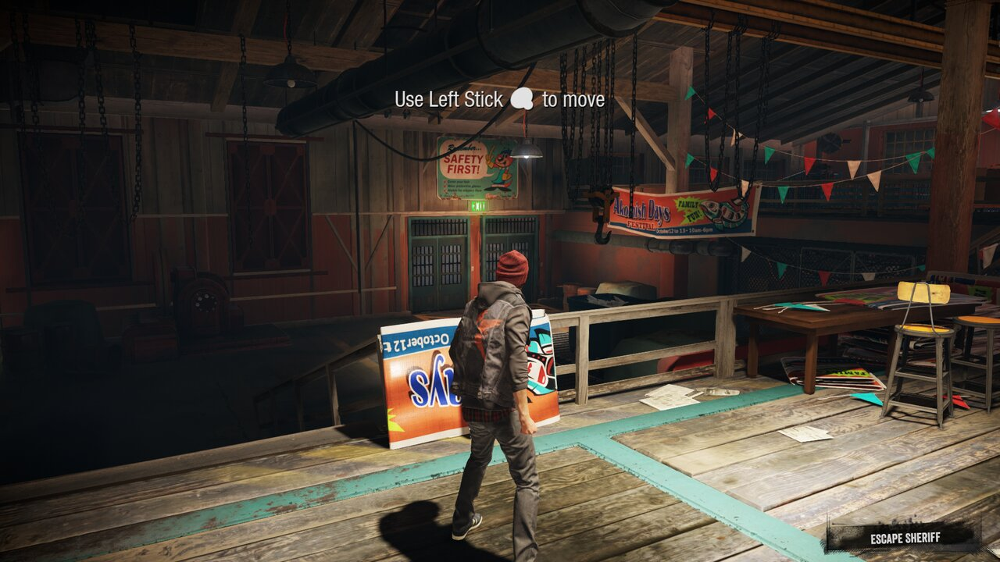
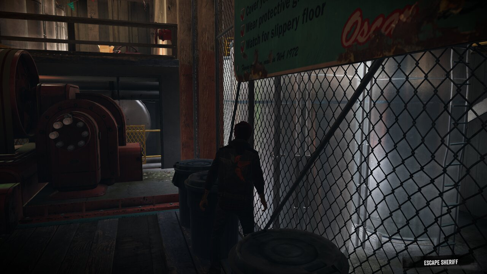
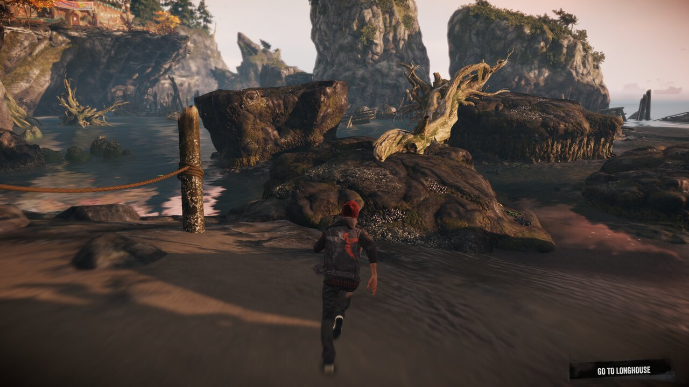
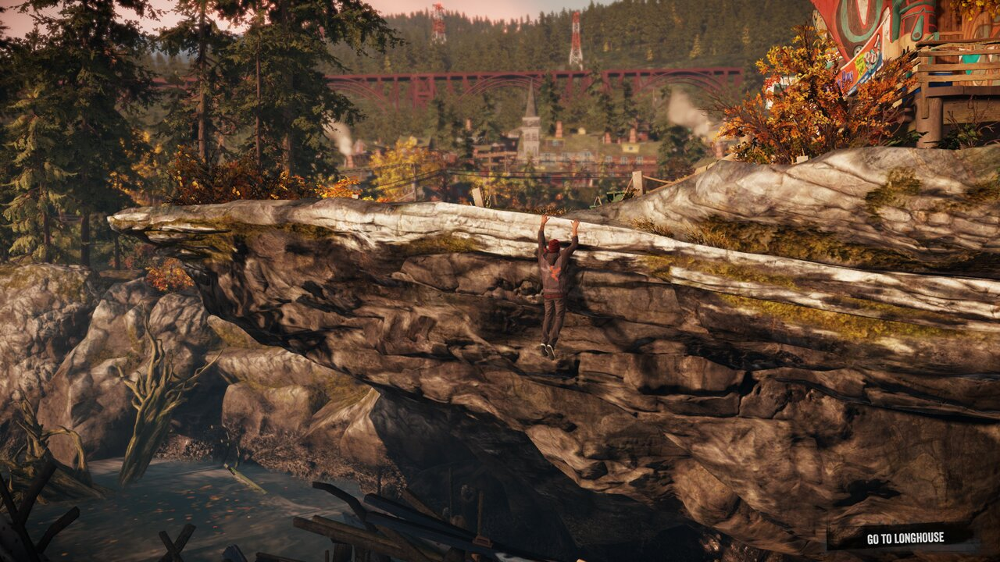
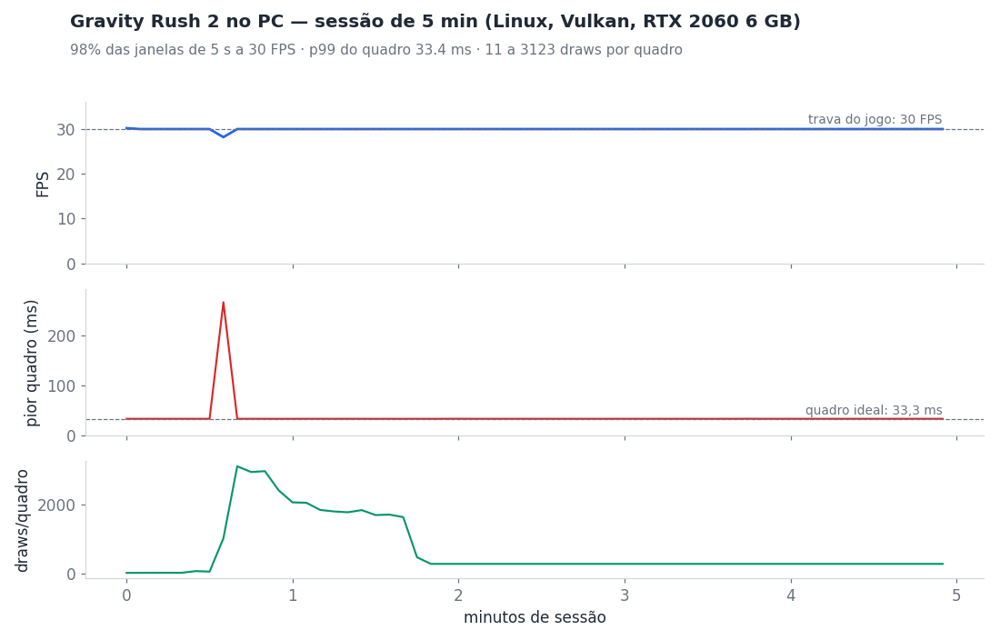

<p align="center"></p>

<h1 align="center">inFAMOUS Second Son — port nativo para PC</h1>

<p align="center">
  <a href="#english"><b>English below</b></a> ·
  <a href="https://github.com/HayatoG/iss_pc/releases/tag/nightly">Download</a> ·
  <a href="https://www.youtube.com/@hayatog-dev">YouTube</a> ·
  <a href="https://discord.gg/UMkdMYZh9g">Discord</a>
</p>

<p align="center"><a href="https://github.com/HayatoG/iss_pc/actions/workflows/build.yml"></a></p>

> **Jogável, em desenvolvimento.** O jogo inicia, chega ao gameplay e passa pelos primeiros capítulos, mas o desempenho ainda é instável (20–30 FPS típicos numa RTX 2060) e há falhas de imagem conhecidas. Veja o [Status](#status).

**inFAMOUS Second Son** (PS4, CUSA00223, jogo base 1.00 + update 1.07) rodando no PC sem emulador de CPU: o código original do jogo roda nativo no processador, o sistema do PS4 é reimplementado e a GPU é traduzida para Vulkan. Usa o mesmo núcleo dos ports de [The Last Guardian](https://github.com/HayatoG/tlg_pc) e [Gravity Rush 2](https://github.com/HayatoG/gr2_pc).

> **Nenhum arquivo do jogo vem com este projeto.** Para jogar, você precisa da sua própria cópia, tirada do seu PS4.

Por **HayatoG** · YouTube [@hayatog-dev](https://www.youtube.com/@hayatog-dev) · Discord [discord.gg/UMkdMYZh9g](https://discord.gg/UMkdMYZh9g)

| | |
|---|---|
|  |  |
|  |  |



<sub>Capturas na resolução nativa (1920×1080, reduzidas para 1280), direto da GPU, no Linux com uma RTX 2060.</sub>

## Novidades

- **Grafite com um analógico só (modo sensor):** o **analógico esquerdo mira** o cursor para os lados e para cima/baixo (antes ele só subia e descia), e um toque no **□ (Quadrado/X no Xbox)** vira o controle de lado ("Hold Wireless Controller Sideways"); outro toque o põe em pé. X/A continua sacudindo. Ver [Sensor de movimento e touchpad](#sensor-de-movimento-e-touchpad).
- **Correções vindas do [shadPS4-Infamous-FixBuild](https://github.com/rayhlancaner-png/shadPS4-Infamous-FixBuild):**
  - **Brilho do Delsin ao drenar energia corrigido:** o stencil passa a respeitar o valor de teste e o de escrita, que são separados no PS4.
  - **Mais FPS:** quando o jogo lê algo da GPU, só a thread que pediu espera, não a GPU inteira (`ISS_DEFERRED_READBACK`, ligado por padrão), e o trabalho vai para a GPU em partes (`ISS_SUBMIT_DRAWS`, padrão 1024).
  - **Menos travadas ao surgir um efeito novo:** os shaders de compute compilam fora da thread da GPU (`ISS_COMPUTE_ASYNC_BUILD`), e o jogo tenta de novo quando o driver falha ao criar um pipeline.
  - **VRAM:** quando a memória de vídeo aperta, o port libera texturas antigas e tenta de novo, em vez de fechar. Uploads gigantes, como ao carregar um save, vão em partes, e o driver pode mover memória para a RAM.
  - **Atomics de float** corrigidos em placas sem suporte nativo, como as NVIDIA.
- **Sensor de movimento:** o giroscópio do DualShock 4/DualSense funciona direto. Em controles sem sensor, um toque em L3+R3 (ou Share no Xbox Series) liga o "modo sensor": o analógico esquerdo mira (o cursor do grafite), o Quadrado/X vira o controle de lado e X/A sacode. No teclado, T/G inclinam e Y sacode. É o que passa do grafite ("Hold Wireless Controller Sideways") e dos outros pedidos de movimento.
- **Analógicos:** zona morta de 10% contra drift (`ISS_STICK_DEADZONE`, também no launcher), e o último controle usado é o que vale.
- **Touchpad sem touchpad:** segure View/Select (ou Tab) e mova o analógico direito (ou as setas) para deslizar o dedo, como no "Open Door"; um toque rápido continua sendo clique.
- **Desempenho:** o FPS não cai mais com o tempo (caía de 60 para 6 em 2 minutos: as variantes de shader nunca se repetiam), e transições parciais de imagem repetidas são puladas.
- **Leitura precisa da GPU por padrão:** a fumaça do dreno de energia, os drones e outras partículas calculadas na GPU aparecem. O modo rápido continua no launcher ("Precisão da GPU").
- **Cache de shaders automático:** a pasta do cache leva a versão do tradutor de shaders, e o cache antigo é apagado sozinho depois de uma atualização.

## Status

| Área | Estado |
|---|---|
| Boot, título, intro e gameplay | ✅ Funciona; testado até "Go to Longhouse", com escalada, corrida, poderes e cutscenes |
| Sensor de movimento (grafite, pedidos de movimento) | ✅ Giroscópio real ou simulado em qualquer controle e no teclado |
| Fumaça do dreno, drones e partículas da GPU | ✅ Com a leitura precisa da GPU (padrão) |
| HUD | ✅ Correto |
| Áudio | ✅ AudioOut + Ajm próprios, sem nenhum arquivo do firmware |
| Saves | ✅ O save é criado e o "Continue" funciona |
| Controle | ✅ DualSense, DualShock 4, Xbox e 8BitDo via SDL3 |
| Desempenho | 🔧 20–30 FPS típicos numa RTX 2060, instável; otimização em andamento |
| Engasgos | 🔧 Na primeira vez que cada shader é compilado (cutscenes e áreas novas) |
| Imagem | 🔧 Alguns efeitos de névoa, água e luz piscam |
| Linux | ✅ Testado (Nobara/Fedora 44) |
| Windows | 🧪 Build automático, ainda sem teste em jogo |



<sub>FPS, pior quadro e draws por quadro a cada 5 s, tirados do log do port (`ISS_FRAME_STATS=1`), na RTX 2060: mediana de 27 FPS, 44% do tempo acima de 30 FPS. O jogo não tem trava de FPS. Gerado por `scripts/session_chart.py` (com `0` = sem trava).</sub>

## Download

O [**build nightly**](https://github.com/HayatoG/iss_pc/releases/tag/nightly) é gerado pelo GitHub Actions a cada mudança e substitui o anterior:

- **Linux x86-64** (glibc 2.39+: Ubuntu 24.04, Fedora 40, SteamOS 3.6 ou mais novos): `infamous-linux-x86_64.tar.gz`
- **Windows 10/11 64 bits**: `infamous-windows-x86_64.zip`

## Arquivos do jogo necessários

Tudo vem do **seu** PS4 (GoldHEN + Itemzflow). Nada disso vai no download. Use **inFAMOUS Second Son CUSA00223 (EUA), jogo base 1.00 com o update 1.07**, montado numa pasta só, com o jogo base e o update por cima. São ~33 GB.

| Arquivo | Vem de | Para quê |
|---|---|---|
| `eboot.bin` | update 1.07 | o código do jogo (tem que ser o do 1.07) |
| `sce_module/libc.prx`, `sce_module/libSceFios2.prx` | update 1.07 | bibliotecas do próprio jogo |
| `sce_sys/` (`param.sfo`, `playgo-chunk.dat`, `icon0.png`, `pic1.png`) | jogo base (+ `param.sfo` do update) | metadados, instalação e a arte do launcher |
| `art/` (`cache/`, `movies/`, `ui/`) | base + update | conteúdo do jogo |
| `playgo.pgm`, `sce_discmap.plt`, `sce_discmap_patch.plt` | base + update | mapa de arquivos e instalação |

**Do firmware do console:** nada. O áudio usa o nosso AudioOut + Ajm; o jogo não importa `libSceNgs2` nem outro módulo do sistema do PS4.

A lista completa e o passo a passo, que também vão nas notas de cada Release, estão em [`docs/ARQUIVOS_NECESSARIOS.md`](docs/ARQUIVOS_NECESSARIOS.md).

**PC:** placa de vídeo com Vulkan 1.3 (6 GB de VRAM recomendados) e ~33 GB livres.

## Como jogar

1. Extraia o pacote.
2. Abra o **inFAMOUS Second Son**, escolha a pasta do jogo e o idioma e clique em **Jogar**. Se a imagem engasgar demais, a opção "Precisão da GPU" tem um modo rápido (sem as partículas da GPU).
3. No jogo, **F10** liga o contador de FPS, e **Insert** (ou R3 + L2 no controle) abre o menu do port.
4. Quando o jogo pedir para virar ou sacudir o controle e o seu não tiver sensor: toque em L3+R3 (ou Share no Xbox Series), use o Quadrado para virar de lado, o analógico esquerdo para mirar e X/A para sacudir, e toque de novo para sair. No teclado: T/G/Y. Veja [Sensor de movimento e touchpad](#sensor-de-movimento-e-touchpad).

O passo a passo completo está em [`README-player.md`](port/packaging/README-player.md), que também vem dentro do pacote.

## Sensor de movimento e touchpad

O jogo pede o sensor de movimento e o touchpad em várias cenas: grafite, absorver poderes (fumaça, neon...), abrir portas e outras interações. No **DualShock 4 e no DualSense** o giroscópio e o touchpad funcionam direto, sem ligar nada. Nos outros controles e no teclado, o port simula os dois.

**Modo sensor (ligar e desligar):**
- **Um toque em L3+R3 juntos** liga o modo sensor; outro toque desliga. Funciona em qualquer controle. Também serve o botão extra do controle: **Share** no Xbox Series, **Capture** no Switch Pro e **microfone** no DualSense. No DualShock 4 e no DualSense, o Share/Create **não** liga o modo sensor: ele é o clique do touchpad.
- Um aviso na tela confirma: "Modo sensor LIGADO: analógico esquerdo mira, Quadrado vira de lado, X sacode" ou "Modo sensor desligado".
- Com o modo ligado, o **analógico esquerdo mira**, girando o controle para os lados e para cima/baixo como uma lata de spray (é o que move o cursor do grafite; ele fica onde você soltou; o direito também serve), um toque no **Quadrado** (X no Xbox) **vira o controle de lado** e outro o põe em pé ("Controle de lado" / "Controle em pé" na tela), e **X/A sacode**. Tudo isso fica escondido do jogo, então o Delsin não anda, não pula e a câmera não gira: **desligue o modo depois da cena**. O L3+R3 juntos também não chega ao jogo.
- Com o modo ligado, a inclinação simulada substitui o giroscópio real.
- **Teclado** (sem modo, a qualquer hora): segure **T** ou **G** para virar o controle de lado (um lado ou o outro) e **Y** para sacudir.

**Touchpad em controle sem touchpad:**
- **View/Select/Back** é o clique do touchpad (lado direito; com L1 segurado, o lado esquerdo). Segurar o botão é segurar o touchpad.
- **Segure View/Select e mova o analógico direito** para deslizar o dedo a partir do meio do touchpad. Um toque rápido sem mover continua sendo clique.
- **Teclado:** Tab (lado esquerdo) e Backspace (lado direito) clicam; **segure Tab e use as setas** para deslizar.

| Ação no jogo | DualShock 4 / DualSense | Xbox / outro controle | Teclado |
|---|---|---|---|
| Absorver/drenar um poder (fumaça, neon...) e interações de "segure o touchpad" | segurar o touchpad | segurar View/Select (sem mexer o analógico direito, senão vira deslize) | segurar Tab ou Backspace (sem as setas) |
| Interação de "toque no touchpad" | clicar o touchpad | toque em View/Select | Tab ou Backspace |
| Grafite: virar o controle de lado | virar o controle | L3+R3 (modo sensor) + um toque no Quadrado | segurar T ou G |
| Grafite: sacudir a lata | sacudir o controle | X/A no modo sensor | Y |
| Grafite: pintar | R2, mirando com o controle | R2, mirando com o analógico esquerdo no modo sensor | F (R2); T/G só viram de lado, sem frente/trás |
| Deslizar no touchpad (porta "Open Door", scanner de mão) | deslizar o dedo | segurar View/Select + analógico direito na direção pedida | segurar Tab + setas |
| Voltar ao normal depois do grafite | — | L3+R3 de novo ("Modo sensor desligado") | — |

**Launcher:** o quadro **Controle** tem a **Zona morta dos analógicos** (0–40%, padrão 10%). Aumente se o personagem, a câmera ou a inclinação do modo sensor se mexerem sozinhos (drift).

**Variáveis de ambiente:** `ISS_MOTION_BUTTON=<botão do SDL>` troca o botão do modo sensor (padrão `misc1`; o L3+R3 vale sempre), e `ISS_MOTION=off` ignora o giroscópio real (a simulação continua funcionando).

**Processadores Intel:** o código do jogo usa instruções SSE4A (EXTRQ), que só existem em processadores AMD. Num Intel o port troca essas instruções por uma emulação na partida (precisa do `iced-x86`, que já vem nos pacotes). `ISS_ISA_REWRITE=sse4a` força a emulação num AMD (teste), `ISS_ISA_REWRITE=1` força todos os conjuntos emulados (MOVBE, BMI1, LZCNT, SSE4A) e `ISS_ISA_REWRITE=0` desliga.

## Compilar do código-fonte

```bash
git clone --recursive https://github.com/HayatoG/iss_pc.git && cd iss_pc
cd port && ISS_LTO=OFF bash build.sh   # Linux: SDL3, Vulkan, FFmpeg, FreeType, Boost, fmt, Zydis, glslang
cd .. && ./infamous_launcher.sh        # ou ./run_infamous.sh pelo terminal
```

No Windows, o build roda no MSYS2 CLANG64 ([`port/packaging/windows/README.md`](port/packaging/windows/README.md)). O workflow [`.github/workflows/build.yml`](.github/workflows/build.yml) mostra o processo completo nas duas plataformas.

## Como funciona

| Camada | O que faz | Base |
|---|---|---|
| Loader | Carrega o `eboot.bin` 1.07 e liga os módulos do próprio jogo (`libc`, `Fios2`) | [tlg_pc](https://github.com/HayatoG/tlg_pc), [gr2_pc](https://github.com/HayatoG/gr2_pc), [gow3_pc](https://github.com/FelipePrado0/gow3_pc), [bloodborne_pc](https://github.com/deadinside28/bloodborne_pc) |
| Runtime | Reimplementa as bibliotecas do PS4 (NpManager, Trophy, Http, PlayGo, SaveData, AppContent, AudioOut, Ajm...). Específicos do inFAMOUS: `port/src/runtime_infamous.c` | `port/src/` |
| Vídeo | Traduz os comandos Gnm e os shaders GCN para Vulkan/SPIR-V | núcleo de vídeo do [shadPS4](https://github.com/shadps4-emu/shadPS4) |

## Próximos passos

O que falta está em [`docs/ROADMAP.md`](docs/ROADMAP.md): desempenho (esperas por leituras da GPU), cache de pipelines em disco contra os engasgos, os efeitos que piscam, o brilho do dreno de drones e os idiomas do jogo no launcher.

## Créditos e aviso legal

Base de código: [tlg_pc](https://github.com/HayatoG/tlg_pc), [gr2_pc](https://github.com/HayatoG/gr2_pc), [gow3_pc](https://github.com/FelipePrado0/gow3_pc) (FelipePrado0), [bloodborne_pc](https://github.com/deadinside28/bloodborne_pc) e [shadPS4](https://github.com/shadps4-emu/shadPS4) e o fork [shadPS4-Infamous-FixBuild](https://github.com/rayhlancaner-png/shadPS4-Infamous-FixBuild) (Eye Of The Ruins/rayhlancaner-png, TOXIC-KID, 0xDeftones), todos GPL-2.0, assim como este projeto ([LICENSE](port/LICENSE)). Áudio ATRAC9 via [LibAtrac9](https://github.com/Thealexbarney/LibAtrac9); fontes via [FreeType](https://freetype.org).

Este projeto não tem vínculo com a Sony Interactive Entertainment ou a Sucker Punch Productions. inFAMOUS é marca da Sony Interactive Entertainment. Nenhum código, arquivo ou arte do jogo é distribuído aqui. O ícone é uma arte original do projeto.

---

<a id="english"></a>

# inFAMOUS Second Son — native PC port

> **Playable, in development.** The game boots, reaches gameplay and gets through the first chapters, but performance is still unstable (20–30 FPS typical on an RTX 2060) and there are known graphics glitches. See the status below.

**inFAMOUS Second Son** (PS4, CUSA00223, base game 1.00 + update 1.07) running on PC without a CPU emulator: the game's original code runs natively on the processor, the PS4 system is reimplemented, and the GPU is translated to Vulkan. It uses the same core as the [The Last Guardian](https://github.com/HayatoG/tlg_pc) and [Gravity Rush 2](https://github.com/HayatoG/gr2_pc) ports.

> **No game files come with this project.** To play, you need your own copy, dumped from your own PS4.

By **HayatoG** · YouTube [@hayatog-dev](https://www.youtube.com/@hayatog-dev) · Discord [discord.gg/UMkdMYZh9g](https://discord.gg/UMkdMYZh9g)

The screenshots are at the top of this page.

## What's new

- **Graffiti with a single stick (sensor mode):** the **left stick aims** the cursor left/right and up/down (it used to move only up and down), and a tap on **square (X on Xbox)** turns the controller on its side ("Hold Wireless Controller Sideways"); another tap puts it upright. Cross/A still shakes. See [Motion sensor and touchpad](#motion-sensor-and-touchpad).
- **Fixes from [shadPS4-Infamous-FixBuild](https://github.com/rayhlancaner-png/shadPS4-Infamous-FixBuild):**
  - **Delsin's glow while draining energy fixed:** stencil now honors both the test and the write values, which are separate on PS4.
  - **More FPS:** when the game reads GPU results, only the thread that asked waits, not the whole GPU (`ISS_DEFERRED_READBACK`, on by default), and work goes to the GPU in pieces (`ISS_SUBMIT_DRAWS`, default 1024).
  - **Fewer hitches when a new effect shows up:** compute shaders compile off the GPU thread (`ISS_COMPUTE_ASYNC_BUILD`), and pipeline creation is retried when the driver fails.
  - **VRAM:** when video memory runs short, the port frees old textures and tries again instead of closing. Huge uploads, such as loading a save, go in parts, and the driver may page memory out to RAM.
  - **Float atomics** fixed on GPUs without native support, such as NVIDIA.
- **Motion sensor:** the DualShock 4/DualSense gyro works as is. On controllers without one, a tap on L3+R3 (or Share on an Xbox Series) toggles "sensor mode": the left stick aims (the graffiti cursor), square/X turns the controller sideways and cross/A shakes it. On the keyboard, T/G tilt and Y shakes. This is what gets you past the graffiti ("Hold Wireless Controller Sideways") and the other motion prompts.
- **Sticks:** a 10% dead zone against drift (`ISS_STICK_DEADZONE`, also in the launcher), and the last controller used is the one that counts.
- **Touchpad without a touchpad:** hold View/Select (or Tab) and move the right stick (or the arrow keys) to swipe, as in "Open Door"; a quick tap still clicks.
- **Performance:** FPS no longer drops over time (it went from 60 to 6 in 2 minutes: shader variants were never reused), and repeated partial image transitions are skipped.
- **Precise GPU readbacks by default:** the energy-drain smoke, drones and other GPU-computed particles show up. The fast mode is still in the launcher ("GPU accuracy").
- **Automatic shader cache:** the cache folder is keyed by the shader recompiler version, and the old cache is deleted on its own after an update.

## Status

| Area | State |
|---|---|
| Boot, title, intro and gameplay | ✅ Works; tested up to "Go to Longhouse", with climbing, running, powers and cutscenes |
| Motion sensor (graffiti, motion prompts) | ✅ Real gyro, or simulated on any controller and the keyboard |
| Drain smoke, drones and GPU particles | ✅ With precise GPU readbacks (default) |
| HUD | ✅ Correct |
| Audio | ✅ Our own AudioOut + Ajm, no firmware file needed |
| Saves | ✅ The save is created and "Continue" works |
| Controller | ✅ DualSense, DualShock 4, Xbox and 8BitDo via SDL3 |
| Performance | 🔧 20–30 FPS typical on an RTX 2060, unstable; optimization ongoing |
| Stutter | 🔧 The first time each shader is compiled (cutscenes and new areas) |
| Graphics | 🔧 Some fog, water and light effects flicker |
| Linux | ✅ Tested (Nobara/Fedora 44) |
| Windows | 🧪 Automatic build, not yet tested in game |


<sub>FPS, worst frame and draws per frame every 5 s, from the port's log (`ISS_FRAME_STATS=1`), on an RTX 2060: median 27 FPS, above 30 FPS 44% of the time. The game has no frame cap. Made with `scripts/session_chart.py` (`0` = uncapped).</sub>

## Download

The [**nightly build**](https://github.com/HayatoG/iss_pc/releases/tag/nightly) is produced by GitHub Actions on every change and replaces the previous one:

- **Linux x86-64** (glibc 2.39+: Ubuntu 24.04, Fedora 40, SteamOS 3.6 or newer): `infamous-linux-x86_64.tar.gz`
- **Windows 10/11 64-bit**: `infamous-windows-x86_64.zip`

## Required game files

Everything comes from **your own** PS4 (GoldHEN + Itemzflow). None of it is in the download. Use **inFAMOUS Second Son CUSA00223 (US), base game 1.00 with update 1.07**, merged into one folder, with the base game and the update on top. About 33 GB.

| File | From | Purpose |
|---|---|---|
| `eboot.bin` | update 1.07 | the game code (must be the 1.07 one) |
| `sce_module/libc.prx`, `sce_module/libSceFios2.prx` | update 1.07 | the game's own libraries |
| `sce_sys/` (`param.sfo`, `playgo-chunk.dat`, `icon0.png`, `pic1.png`) | base game (+ the update's `param.sfo`) | metadata, install info and the launcher art |
| `art/` (`cache/`, `movies/`, `ui/`) | base + update | game content |
| `playgo.pgm`, `sce_discmap.plt`, `sce_discmap_patch.plt` | base + update | file map and install info |

**From the console firmware:** nothing. Audio uses our own AudioOut + Ajm; the game imports neither `libSceNgs2` nor any other PS4 system module.

The full list and the step-by-step guide, which also go in the notes of every Release, are in [`docs/ARQUIVOS_NECESSARIOS.md`](docs/ARQUIVOS_NECESSARIOS.md).

**PC:** a graphics card with Vulkan 1.3 (6 GB of VRAM recommended) and ~33 GB free.

## How to play

1. Extract the package.
2. Open **inFAMOUS Second Son**, pick the game folder and the language, and click **Play**. If it stutters too much, the "GPU accuracy" option has a fast mode (without GPU particles).
3. In game, **F10** toggles the FPS counter, and **Insert** (or R3 + L2 on a controller) opens the port's menu.
4. When the game asks you to turn or shake the controller and yours has no sensor: tap L3+R3 (or Share on an Xbox Series), use the left stick to tilt and cross/A to shake, and tap again to leave. On the keyboard: T/G/Y. See [Motion sensor and touchpad](#motion-sensor-and-touchpad).

The full guide is in [`README-player.md`](port/packaging/README-player.md), which also ships inside the package.

## Motion sensor and touchpad

The game asks for the motion sensor and the touchpad in many scenes: graffiti, absorbing powers (smoke, neon...), opening doors and other interactions. On a **DualShock 4 or DualSense** the gyro and the touchpad work as is, with nothing to turn on. On other controllers and on the keyboard, the port simulates both.

**Sensor mode (turning it on and off):**
- **One tap on L3+R3 together** turns sensor mode on; another tap turns it off. It works on any controller. The controller's extra button works too: **Share** on an Xbox Series, **Capture** on a Switch Pro and the **microphone** button on a DualSense. On a DualShock 4 or DualSense, Share/Create does **not** toggle sensor mode: it is the touchpad click.
- A notice on screen confirms it: "Sensor mode ON: left stick aims, square turns it sideways, cross shakes" or "Sensor mode off".
- While it is on, the **left stick aims**, turning the controller left/right and up/down like a spray can (this moves the graffiti cursor; it stays where you let go; the right stick works too), a tap on **square** (X on Xbox) **turns the controller on its side** and another puts it upright ("Controller on its side" / "Controller upright" on screen), and **cross/A shakes** it. All of it is hidden from the game, so Delsin neither walks nor jumps and the camera does not turn: **turn the mode off after the scene**. L3+R3 together never reaches the game either.
- While it is on, the simulated tilt replaces the real gyro.
- **Keyboard** (no mode needed, any time): hold **T** or **G** to turn the controller sideways (one side or the other) and **Y** to shake it.

**Touchpad on a controller without one:**
- **View/Select/Back** is the touchpad click (right side; with L1 held, the left side). Holding the button holds the touchpad.
- **Hold View/Select and move the right stick** to swipe a finger from the middle of the touchpad. A quick tap without moving still clicks.
- **Keyboard:** Tab (left side) and Backspace (right side) click; **hold Tab and use the arrow keys** to swipe.

| In-game action | DualShock 4 / DualSense | Xbox / other controller | Keyboard |
|---|---|---|---|
| Absorb/drain a power (smoke, neon...) and "hold the touchpad" interactions | hold the touchpad | hold View/Select (leave the right stick alone, or it becomes a swipe) | hold Tab or Backspace (no arrow keys) |
| "Press the touchpad" interactions | click the touchpad | tap View/Select | Tab or Backspace |
| Graffiti: turn the controller sideways | turn the controller | L3+R3 (sensor mode) + a tap on square | hold T or G |
| Graffiti: shake the can | shake the controller | cross/A in sensor mode | Y |
| Graffiti: spray | R2, aiming with the controller | R2, aiming with the left stick in sensor mode | F (R2); T/G only turn sideways, no forward/back |
| Touchpad swipe ("Open Door", hand scanner) | swipe a finger | hold View/Select + right stick in the asked direction | hold Tab + arrow keys |
| Back to normal after the graffiti | — | L3+R3 again ("Sensor mode off") | — |

**Launcher:** the **Controller** box has the **Stick dead zone** (0–40%, default 10%). Raise it if the character, the camera or the sensor-mode tilt moves on its own (stick drift).

**Environment variables:** `ISS_MOTION_BUTTON=<SDL button>` changes the sensor-mode button (default `misc1`; L3+R3 always works), and `ISS_MOTION=off` ignores the real gyro (the simulation still works).

**Intel CPUs:** the game's code uses SSE4A instructions (EXTRQ), which only AMD CPUs have. On Intel the port replaces them with an emulation at start (needs `iced-x86`, included in the packages). `ISS_ISA_REWRITE=sse4a` forces the emulation on AMD (testing), `ISS_ISA_REWRITE=1` forces every emulated set (MOVBE, BMI1, LZCNT, SSE4A) and `ISS_ISA_REWRITE=0` turns it off.

## Building from source

```bash
git clone --recursive https://github.com/HayatoG/iss_pc.git && cd iss_pc
cd port && ISS_LTO=OFF bash build.sh   # Linux: SDL3, Vulkan, FFmpeg, FreeType, Boost, fmt, Zydis, glslang
cd .. && ./infamous_launcher.sh        # or ./run_infamous.sh from a terminal
```

On Windows, the build runs in MSYS2 CLANG64 ([`port/packaging/windows/README.md`](port/packaging/windows/README.md)). The workflow [`.github/workflows/build.yml`](.github/workflows/build.yml) shows the full process on both platforms.

## How it works

| Layer | What it does | Based on |
|---|---|---|
| Loader | Loads the 1.07 `eboot.bin` and links the game's own modules (`libc`, `Fios2`) | [tlg_pc](https://github.com/HayatoG/tlg_pc), [gr2_pc](https://github.com/HayatoG/gr2_pc), [gow3_pc](https://github.com/FelipePrado0/gow3_pc), [bloodborne_pc](https://github.com/deadinside28/bloodborne_pc) |
| Runtime | Reimplements the PS4 libraries (NpManager, Trophy, Http, PlayGo, SaveData, AppContent, AudioOut, Ajm...). inFAMOUS-specific: `port/src/runtime_infamous.c` | `port/src/` |
| Video | Translates Gnm commands and GCN shaders to Vulkan/SPIR-V | [shadPS4](https://github.com/shadps4-emu/shadPS4) video core |

## Next steps

What is left is in [`docs/ROADMAP.md`](docs/ROADMAP.md): performance (waits on GPU readbacks), an on-disk pipeline cache against the stutter, the flickering effects, the drone-drain glow and the game languages in the launcher.

## Credits and legal notice

Code base: [tlg_pc](https://github.com/HayatoG/tlg_pc), [gr2_pc](https://github.com/HayatoG/gr2_pc), [gow3_pc](https://github.com/FelipePrado0/gow3_pc) (FelipePrado0), [bloodborne_pc](https://github.com/deadinside28/bloodborne_pc) and [shadPS4](https://github.com/shadps4-emu/shadPS4) and the [shadPS4-Infamous-FixBuild](https://github.com/rayhlancaner-png/shadPS4-Infamous-FixBuild) fork (Eye Of The Ruins/rayhlancaner-png, TOXIC-KID, 0xDeftones), all GPL-2.0, as is this project ([LICENSE](port/LICENSE)). ATRAC9 audio via [LibAtrac9](https://github.com/Thealexbarney/LibAtrac9); fonts via [FreeType](https://freetype.org).

This project is not affiliated with Sony Interactive Entertainment or Sucker Punch Productions. inFAMOUS is a trademark of Sony Interactive Entertainment. No game code, files or art are distributed here. The icon is original artwork made for this project.
